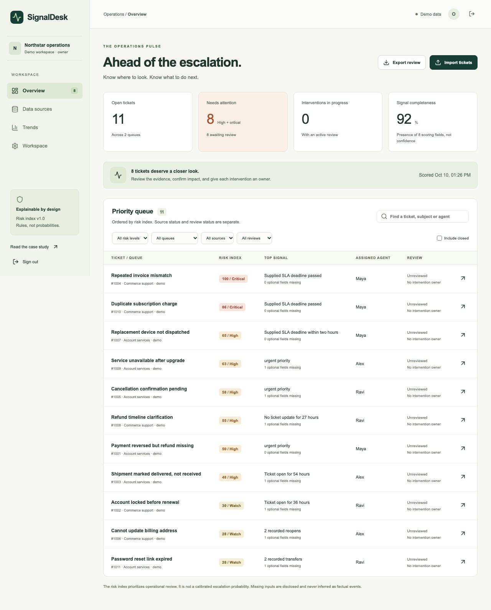

# SignalDesk — escalation monitoring for BPO operations

A rebuilt product from the original Predictive Escalation Risk Model experiment. Import ticket CSVs or connect a customer-owned Zendesk account, inspect explainable risk signals, and assign follow-up actions.



## Run locally

Requires Node.js 24. No Python, database server, paid AI API, or Zendesk account is needed for the demo.

```sh
cd web
npm ci
npm run build
npm start
```

Open http://127.0.0.1:3001. Choose **Explore the live demo** for an isolated workspace with fictional tickets. `npm start` runs both the web server and the Zendesk polling worker. `npm run dev` runs only the web server; run `npm run worker` separately if developing the connector (provide its environment variables in the shell).

## What is included

- Public landing page and portfolio case study with a two-minute walkthrough.
- Isolated seven-day demos and empty private workspaces.
- Owner/read-only access keys, server-side sessions, viewer revocation.
- CSV column mapping, row-level validation, preview, atomic upsert, sample file.
- Priority queue, risk/queue/source/review filters, intervention owner and notes.
- Deterministic risk index with point-by-point explanations and missing-data indicators.
- Zendesk customer-hosted incremental polling, encrypted credentials, cursor checkpoints, retries, deletion handling, pause/disconnect, worker health and freshness indicators.
- Queue snapshots, source-specific clearing, spreadsheet-safe CSV exports.
- Docker, Compose, Render blueprint, automated checks.
- Separate offline training/evaluation workflow with genuine outcome contracts, temporal split and a 24-hour embargo.

## Important product boundaries

The displayed risk index is **not an escalation probability**. The old model is not loaded. Original metrics came from 40 rows and are not evidence of production prediction quality. Read [the audit](docs/REPOSITORY-AUDIT.md) and [model methodology](docs/MODEL-CARD.md).

Zendesk synchronization is **near-real-time polling**, not streaming or a webhook. It imports ticket metadata only; transfer/reopen counts, customer response delay, and SLA deadlines remain missing. Initial lookback defaults to 30 days, so older unchanged tickets are not a complete historical backlog. Customer-hosted API-token connections are supported; this is not a Zendesk Marketplace OAuth app.

Private workspace keys are shared credentials, not individual SSO accounts. SQLite persistence and one web/worker instance are intended for small pilots (10,000 tickets per workspace), not a large multi-tenant SaaS launch. No automatic Zendesk writes, Slack/email notifications, business-hours SLA engine, or trained production predictor is claimed.

## Guides

- [Setup, hosting, access and backups](docs/DEPLOYMENT.md)
- [Zendesk integration and data contract](docs/ZENDESK.md)
- [Product scope and roadmap](docs/PRODUCT-BRIEF.md)
- [Model card and evaluation](docs/MODEL-CARD.md)
- [Validation evidence](docs/VALIDATION.md)
- [Portfolio and resume copy](docs/PORTFOLIO.md)

## Checks

```sh
cd web
npm run test
npm run lint
npm run build
npm run typecheck
npm run test:e2e
```

For offline research, use Python 3.12 and `research/requirements.txt`; the web application does not depend on that environment.

## Repository layout

`web/` is the supported product; `research/` is the new candidate-evaluation workflow. The original `api/`, `dashboard/`, `etl/`, `models/`, `notebooks/`, and misspelled UTF-16 `requirments.txt` remain historical reference material. Do not use them for the new runtime. The original README is archived in [docs/LEGACY-README.md](docs/LEGACY-README.md).
