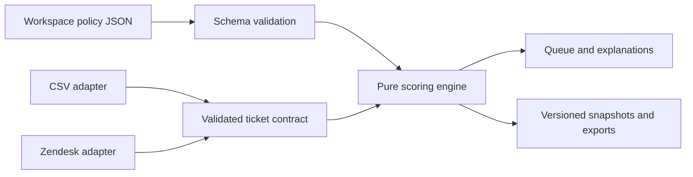

# Business rules without code changes

Workspace owners can now open **Workspace → Business rules** and customize their scoring policy. Viewers can inspect and export the active configuration but cannot preview or publish changes.

## What owners can change

- Watch, High and Critical band thresholds.
- Enabled rules, conditions, point contributions and contribution caps.
- Priority, age, inactivity, supplied transfer/reopen counts, response delay and supplied SLA deadline conditions.
- Per-event multiplication for transfer/reopen counts.
- Queue-specific rules using exact group names (blank means all queues).
- Suggested next action shown for each matched rule.
- Add or remove rules, import/export reusable policy JSON, restore earlier versions.

Example: a premium queue might flag 4 hours without an update, while a standard queue flags 8 hours. Create a second inactivity rule scoped to the premium queue, choose an “at least” threshold of 4 and an appropriate point contribution. Preview its effect on the actual tickets before applying it.

## Change workflow

1. Sign in with an owner key and open Workspace.
2. Edit the policy name, thresholds and rules. Expand a rule to edit its details. Changes remain local to the draft.
3. Choose **Preview policy impact**. Review changed-ticket counts, High/Critical counts before and after, and up to ten of the largest changes. No active scores are changed yet.
4. Choose **Apply policy version N**. The server validates the same configuration and updates all current scoring paths: dashboard, CSV preview, export, sync snapshots and trend aggregation.
5. To undo, load an earlier version into the draft, preview, and apply it as a new version. Historical records are never overwritten.

The preview is bound to the workspace, policy content, active revision and current ticket data, and expires after five minutes. Edited tickets, another published policy, or an expired preview require a new preview. Time-based signals are recomputed on apply/read, so a ticket crossing a time threshold after preview may have a different score. Unsaved drafts are local to the browser; a newly published active version refreshes the editor.

Exported JSON is configuration, not executable code. Import validates the schema and limits before updating the draft. Exporting a draft does not publish it. Store exported policies in your normal configuration review process.

## Fixed semantics

Scores are bounded 0–100. Thresholds must satisfy Watch < High < Critical. Contributions are nonnegative. Solved/closed tickets always score zero. Missing signals never satisfy a condition. The **largest matching contribution for each signal** wins; age tiers do not stack. Equal contributions use the first rule in policy order. The seven signal contributions then sum, capped at 100. Per-event calculations are supported only for transfers/reopens. Suggested actions are text; they do not trigger integrations or alter source tickets.

Queues are matched exactly and case-sensitively. A broad rule and queue-specific rule on the same signal compete by contribution; a queue rule does not automatically override a larger global rule. To lower a queue's contribution, scope the global rule to the other queues explicitly.

Limits: 30 rules, 20 queue names per rule, 200 published versions per workspace, five-minute preview lifetime. Up to 20 recent versions appear in the editor; all stored versions remain in the database. Version 0 records the original default configuration, including for workspaces upgraded from the initial release. Historical snapshots retain their original policy version. CSV review exports include `policy_revision`; never compare trends across versions without considering the rule change.

## Modular implementation

| Module | Responsibility |
| --- | --- |
| `web/lib/domain.ts` | Canonical ticket schema and sample data |
| `web/lib/scoring/policy.ts` | Policy schema, allowed signals, original defaults |
| `web/lib/scoring/engine.ts` | Pure ticket + timestamp + policy → score and evidence |
| `web/lib/scoring/service.ts` | Preview binding, optimistic concurrency, publishing |
| `web/lib/db.ts` | Workspace policy versions and snapshot persistence |
| `web/components/policy-editor.tsx` | Owner-facing editing, preview, import/export and restore |

The evaluator has no network access, database calls, or `eval`. Ingestion adapters do not own scoring logic. The optional research pipeline is separate and unaffected by rule changes; editing an operational policy does not train or validate a model.

## Extending beyond the current signals

New data signals, complex multi-field expressions, custom business calendars, automated escalation actions and external notification workflows still require a developer extension. To add a signal, extend the canonical ticket schema and ingestion mapping, add a typed field and validation to the policy registry, implement its value calculation in the evaluator, and add missingness, boundary and adapter-parity tests. Do not add arbitrary uploaded JavaScript/Python execution to the policy editor.
